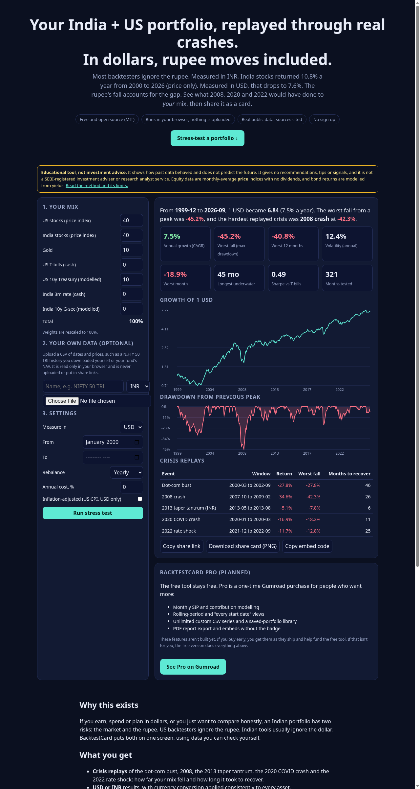

# BacktestCard

**A free, open-source portfolio stress tester for Indian investors who measure in USD.** Replay the dot-com bust, 2008, the 2013 taper tantrum, COVID and 2022 on real public data, with the rupee's effect included, then share the result as a PNG card or a link, or embed it.

> Educational tool, not investment advice. It gives no recommendations or signals and is not SEBI-registered.



## Features
- Seven bundled assets: US and India equities (OECD price indices), gold (World Bank), US T-bills and a modelled 10y Treasury (Fed), and India 3m rates and a modelled 10y G-sec (OECD).
- Results in **USD or INR**, with FX applied consistently to every asset (Fed H.10). Optional real returns via US CPI.
- Rebalancing (monthly, yearly or never) and an annual cost drag.
- Metrics: CAGR, max drawdown, worst month and worst 12 months, volatility, Sharpe vs T-bills, longest time underwater, and crisis replays with months to recover.
- **Bring your own CSV** (e.g. a NIFTY 50 TRI or a fund NAV), processed only in the browser.
- **Share**: the URL hash holds the full state (`#p=us_eq:60,in_eq:40&s=2000-01&c=USD&r=A`), a 1200×630 PNG card, and an `?embed=1` iframe mode with a "Made with BacktestCard" badge.
- No backend, no tracking, no dependencies. Static files only.

## BacktestCard Pro ($9 one-time, Gumroad)
Pro is unlocked by a Gumroad licence key, verified in the browser (`pro.js` → `api.gumroad.com/v2/licenses/verify`) and re-checked weekly. It adds unlimited CSVs (free: 1), a PDF report (`pdf.js`, dependency-free), share cards without the badge, and saved portfolios (localStorage). Set `GUMROAD_PRODUCT_ID` in `pro.js` once the product exists. Until then, Unlock refuses every key. Because the check runs client-side, it can be bypassed; it's there to make paying easy, not as DRM.

## Run locally
```
python3 -m http.server 8000   # then open http://localhost:8000
```

## Rebuild the data
```
python3 scripts/build_data.py           # downloads from Fed, BLS, OECD and the World Bank into raw/ (git-ignored)
python3 scripts/build_data.py --offline # rebuild from the raw/ cache
```
Needs Python 3.10+, pandas and openpyxl. Sources and licences: [DATA_SOURCES.md](DATA_SOURCES.md).

## Tests
```
node tests/unit.test.js            # 13 unit tests: bond maths, FX, CSV, URL sanitising, no-lookahead
node tests/pro.test.js             # 7 tests: licence logic (mocked Gumroad), PDF validity
python3 tests/test_independent.py  # separate pandas implementation, all stats must match to 1e-9
```

## Method
Returns are monthly and use only past data. A month's return uses the end of the previous month and that month itself. FX converts INR asset returns into USD as `(1+r)·X[t-1]/X[t] − 1`, where X is INR per USD. Bonds: a 10-year par bond bought at the previous month's yield is revalued at this month's yield, using the dirty price for 9 11/12 years to maturity. This engine's logic is taken from an earlier audited Python research engine, keeping its fixes: one currency throughout, cash earns a yield, and price-only data is disclosed as such.

## Deploy (GitHub Pages)
Push to a public repo, then go to Settings → Pages → Source: GitHub Actions. The included `.github/workflows/pages.yml` runs the tests and publishes the site.

## Licence
Code: MIT. Data: under each publisher's terms (see DATA_SOURCES.md).
